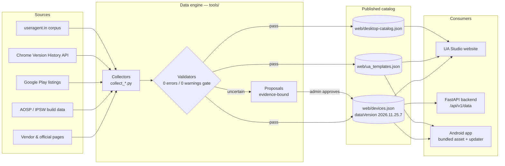
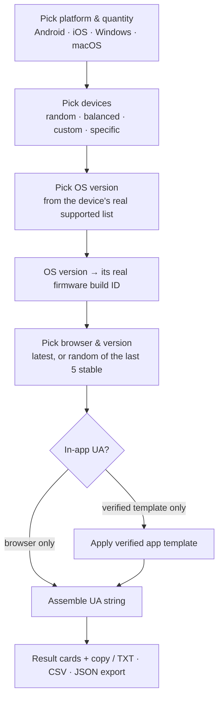
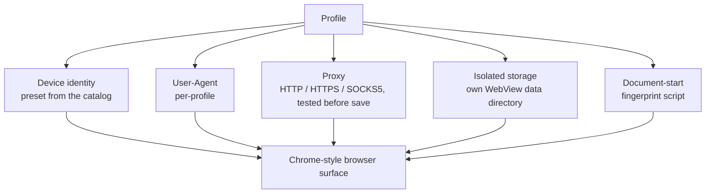

<div align="center">

# NEXORA

**Private browsing. Total control.**
**An evidence-backed User-Agent data engine, a public UA Studio, and an Android profile browser — in one repository.**

[](#the-data)
[-informational)](#the-data)
[](#the-data)
[](#user-agent-templates)
[](#nexora-android-app)
[](https://nexorauser.vercel.app/)

</div>

---

## What is NEXORA?

NEXORA is one project with three parts that share a single source of truth — a
**verified device & user-agent database**:

| Part | What it is | Where it lives |
|---|---|---|
| **User-Agent Studio** | The public website. Generate realistic browser & in-app user-agent strings for Android, iOS, Windows and macOS from the real catalog — no invented values. | [`web/`](web/) · live at [nexorauser.vercel.app](https://nexorauser.vercel.app/) |
| **Data engine** | Collectors, validators and a FastAPI backend that keep the catalog true: every value carries a source, and nothing publishes without passing validation. | [`tools/`](tools/) · [`backend/`](backend/) · [`data/`](data/) |
| **NEXORA Android app** | A WebView-class profile browser: isolated profiles, each with its own device identity, user-agent and proxy. | [`app/`](app/) |

The golden rule of the whole project: **evidence or empty.** A device spec, a
firmware build, an app version or a UA template exists in the catalog only
with a source behind it. AI may *propose* data; it never publishes unverified
data.

---

## Table of contents

- [How it works](#how-it-works)
- [The data](#the-data)
- [User-Agent Studio (website)](#user-agent-studio-website)
- [NEXORA Android app](#nexora-android-app)
- [Repository map](#repository-map)
- [Quick start](#quick-start)
- [Admin & API](#admin--api)
- [Automation](#automation)
- [Testing & validation](#testing--validation)
- [Project status](#project-status)
- [Documentation](#documentation)
- [Honest limitations](#honest-limitations)

---

## How it works

### The data pipeline

Data flows one way: **sources → collectors → validators → catalog → consumers.**
Visitors and the app never call an outside API per request; they read the
stored catalog.



Two publishing paths, no exceptions:

- **Trusted & narrow** — a short allowlist of structured sources (currently
  Chrome Stable versions) may auto-publish after deterministic validation.
- **Everything else is a proposal** — new devices and app versions discovered
  from official pages become evidence-bound proposals that a signed-in admin
  approves or rejects. AI extraction assists the proposal; it never writes
  the catalog directly.

### Generating a user-agent



Every token in the output traces back to a catalog row: device model → its
paired OS versions → the build ID that belongs to that OS version → a real
app version↔build pair or browser version. That pairing discipline is what
makes a generated UA *coherent*, not just plausible-looking.

### The Android profile model



---

## The data

Current published catalog (`web/devices.json`, schema v2):

| | |
|---|---|
| **dataVersion** | `2026.11.25.7` (2026-11-25) |
| **Devices** | **59** — 44 Android + 15 iPhone |
| **Apps** | **18**, each with 10 version↔build pairs (180 historical pairs) |
| **Firmware** | 216 recent Android builds (5 per device where available) |
| **Markets** | Per-device market codes; AU/CA/GB/US is the Tier-1 default set |
| **Browser versions** | Last 5 stable versions × 8 browser/platform lists, from vendor sources, with retained evidence (`data/evidence/`) |
| **Validation** | `validate_devices.py` — 0 errors / 0 warnings on the published catalog |

### User-Agent templates

In-app UAs (Facebook, Instagram, …) are **not** derived from app version data.
They live in a separate catalog, `web/ua_templates.json`, under a stricter
rule (see [`docs/UA_TEMPLATES_SPEC.md`](docs/UA_TEMPLATES_SPEC.md)): a
template becomes **verified** only with two independent sources showing the
same format.

| Status | Count | Meaning |
|---|---|---|
| `verified` | **1** | Facebook (Android) — selectable everywhere |
| `candidate` | **11** | Observed formats, not yet corroborated — labelled, never presented as verified |
| `pending` | 0 published | Still being collected |

An app unlocks for generation only when its template is `verified`.

---

## User-Agent Studio (website)

The public site opens directly into the generator — no landing-page detour.

- **Platforms:** Android, iOS, Windows, macOS — independent quantities,
  combined batch limit **500**
- **Distribution:** random · balanced · custom per-device · specific devices
  (searchable picker)
- **Countries:** market-aware device filtering; locale / Accept-Language
  exported as metadata, never stuffed into the UA string
- **Browser versions:** latest by default, random-from-last-5 mode, or an
  explicit manual value — a version not in the catalog stays manual, never
  silently guessed
- **In-app UAs:** opt-in toggle; only `verified` templates generate
- **Output:** result cards with brand mark + model, copy one / copy all,
  **TXT** (one raw UA per line), CSV and JSON export, local saved sets
  (browser storage only — nothing uploaded)
- **Legacy generator:** the original generator is preserved at
  [`web/generator-legacy.html`](web/generator-legacy.html)
- **Admin** (sign-in at `/admin`): device catalog CRUD, app versions,
  compatibility coverage, source automation, proposal review queue, AI
  assistant, audit log — all behind the admin API, no secrets in the
  frontend

---

## NEXORA Android app

`app/` — package `com.nexora.browser`, currently **0.4.0-alpha29**
(versionCode 33), Android 13+ target line, WebView-class (Stage A).

- **Profile manager** — create, edit, duplicate, delete; bulk create 1–50;
  **Profile Studio** with Android/iOS quantities and random / balanced /
  custom device distribution
- **26+ device presets** in the bundled catalog, per-profile user-agent
  (including the standalone **UA Generator**: batches of 1–500, saved
  batches, handoff into Profile Studio)
- **Per-profile proxy** — HTTP / HTTPS / SOCKS5 with test-before-save;
  proxy locale & timezone resolved from the proxy's exit IP
- **Isolation** — each profile gets its own WebView storage; a
  document-start fingerprint script applies the profile's identity
- **Chrome-style UI** — the browsing surface mirrors Chrome for Android;
  NEXORA extras live in their own menu group and screens (Compatibility
  Lab, Feature Center, Privacy Center, proxy library, backup/restore with
  encrypted portable backups)

Stage B — an engine-level Chromium fork — is the roadmap, gated on a real
build machine. Nothing in the current app claims engine-level spoofing.

---

## Repository map

```text
NEXORA/
├── app/                    # Android app (Kotlin, Gradle) — com.nexora.browser
├── web/                    # UA Studio: index.html, app.js, styles.css
│   ├── devices.json        # Published device catalog (fallback + API seed)
│   ├── ua_templates.json   # Published UA template catalog
│   ├── desktop-catalog.json# Windows/macOS catalog
│   └── generator-legacy.*  # Preserved original generator
├── backend/                # FastAPI service
│   ├── app.py              # Public + admin APIs, models, auth
│   ├── celery_app.py       # Optional scheduled worker config
│   └── tasks.py            # Source-monitor task
├── tools/                  # Collectors, normalizers, validators (Python)
├── data/                   # Evidence, history, proposals, source material
├── tests/                  # pytest suite + desktop UA smoke test (Node)
├── docs/                   # Specs: technical, data plan, deployment, UA templates
├── config/                 # Source registry
├── .github/workflows/      # Build + scheduled data refresh (see Automation)
├── docker-compose.yml      # PostgreSQL + Redis + worker + scheduler stack
├── PROJECT_CONTEXT.md      # Canonical project handoff — read this first
├── AGENTS.md               # Rules for AI agents working in this repo
└── CHANGELOG.md
```

---

## Quick start

### Website + API, one process (SQLite, fastest)

```bash
python -m pip install -r requirements.txt        # Python 3.12+
cp .env.example .env                             # set NEXORA_ADMIN_PASSWORD
                                                 # and NEXORA_SECRET_KEY (≥ 32 chars)
uvicorn backend.app:app --reload --port 8000
```

Open <http://localhost:8000> — API docs at <http://localhost:8000/docs>.

### Full stack (PostgreSQL + Redis + worker + scheduler)

```bash
cp .env.example .env        # set POSTGRES_PASSWORD, NEXORA_ADMIN_PASSWORD, NEXORA_SECRET_KEY
docker compose up --build
```

The Celery Beat scheduler runs the official source monitor every 24 hours;
a manual run is available in the admin Automation Center.

### Website only (static)

Serve `web/` with any static host. The Studio reads `/api/v1/data` when an
API is configured (`web/config.js`) and falls back to the bundled
`web/devices.json`. This is how the Vercel deployment runs.

### Android app

```bash
./gradlew :app:assembleDebug     # JDK 17, Android SDK 34
./gradlew :app:testDebugUnitTest
```

### Environment variables

| Variable | Required | Purpose |
|---|---|---|
| `DATABASE_URL` | Production | PostgreSQL URL; SQLite is the local default |
| `NEXORA_ADMIN_PASSWORD` | Admin | Shared administrator password |
| `NEXORA_SECRET_KEY` | Admin | Session signing key, minimum 32 characters |
| `AI_API_KEY` | Optional | Server-side AI provider key (assistant + extraction) |
| `AI_API_BASE_URL` | Optional | Provider base URL (OpenAI-compatible) |
| `AI_MODEL` | Optional | Defaults to `gpt-4.1-mini` |
| `CORS_ORIGINS` | Production | Allowed frontend origins |
| `CELERY_BROKER_URL` / `CELERY_RESULT_BACKEND` | Worker | Redis URLs |
| `NEXORA_DATA_FILE` | Optional | Alternate catalog seed file |

> Never put admin passwords, signing keys or AI keys in `web/config.js`,
> HTML, JavaScript, or any public file.

---

## Admin & API

### Public

| Endpoint | Purpose |
|---|---|
| `GET /api/v1/health` | Service health |
| `GET /api/v1/data` | The full published catalog (website + Android updater read this) |
| `GET /api/v1/stats` | Catalog counts |
| `GET /api/v1/devices` | Device list |

### Administrator (Bearer token, from `POST /api/v1/admin/login`)

Catalog CRUD (`/admin/devices`, `/admin/app-versions`), source control
(`/admin/sources`, `/admin/refresh`, `/admin/runs`), proposal review
(`/admin/proposals`, `/admin/proposals/{id}/decision`), system overview
(`/admin/overview`), audit log (`/admin/audit`) and the read-only AI
assistant (`/admin/ai/assist`).

---

## Automation

| Workflow | Cadence | What it does |
|---|---|---|
| `build.yml` | On push | Validates the Android catalog asset, builds the app |
| `refresh.yml` | Weekly | Refreshes device/app versions from official sources into both catalog mirrors |
| `nexora-specs-refresh.yml` | Monthly | Collects device specs, runs strict validation, opens a review proposal |
| `ua-templates-collect.yml` | Quarterly | Collects UA-template candidates and opens a **draft PR only** — it can never auto-publish |

---

## Testing & validation

```bash
# Catalog gates (must be 0 errors / 0 warnings on published data)
python tools/validate_devices.py web/devices.json
python tools/validate_ua_templates.py

# Python suite (API, collectors, pipelines)
DATABASE_URL=sqlite:////tmp/nexora-test.db \
NEXORA_ADMIN_PASSWORD='test-only-password' \
NEXORA_SECRET_KEY='test-secret-key-that-is-at-least-32-characters' \
pytest -q

# JavaScript syntax + desktop UA smoke test
node --check web/app.js && node --check web/generator-legacy.js
node tests/desktop-ua-smoke.js

# Python syntax
python -m compileall backend tools
```

---

## Project status

- **Data (Workstream A)** — complete and published; catalog
  `2026.11.25.7`, validators 0/0.
- **UA templates (Workstream B)** — collection pipeline live; 1 verified
  record (Facebook Android), 11 candidates under the two-source rule.
- **Android app (Workstream C)** — Alpha29 is the current build. A full
  independent audit (line-by-line code review, a 71-group feature truth
  table, and a data/website evidence pass) produced a ~70-finding register;
  the fix campaign ships as **0.4.0-alpha30**: security & data-loss fixes
  first, then app correctness, backend/data integrity, website truth fixes,
  and every PARTIAL feature traced end-to-end. Device-only behaviour stays
  explicitly UNVERIFIED until phone-tested.
- **Known open items** — the app's bundled catalog is a subset of the web
  catalog (the app updater syncs it at runtime); production hardening
  (per-user admin accounts, MFA, managed backups) is pre-launch work, see
  below.

---

## Documentation

| Doc | Contents |
|---|---|
| [`PROJECT_CONTEXT.md`](PROJECT_CONTEXT.md) | Canonical handoff: mission, architecture, status, roadmap |
| [`docs/TECHNICAL_SPEC.md`](docs/TECHNICAL_SPEC.md) | Product & system specification |
| [`docs/DEPLOYMENT.md`](docs/DEPLOYMENT.md) | Local & production deployment |
| [`docs/DATA_PLAN.md`](docs/DATA_PLAN.md) · [`docs/DATA_SYSTEM_PROMPT.md`](docs/DATA_SYSTEM_PROMPT.md) | Data collection design |
| [`docs/UA_TEMPLATES_SPEC.md`](docs/UA_TEMPLATES_SPEC.md) | UA template evidence & verification rules |
| [`docs/WEBSITE_GENERATOR_REDESIGN.md`](docs/WEBSITE_GENERATOR_REDESIGN.md) · [`docs/WEBSITE_UX_REDESIGN_V2.md`](docs/WEBSITE_UX_REDESIGN_V2.md) | Website design history & rules |
| [`AGENTS.md`](AGENTS.md) | Binding rules for AI agents in this repo |

---

## Honest limitations

- The Android app is **WebView-class**: identity is applied at the WebView
  and script level, not in a Chromium engine fork. Treat fingerprint claims
  accordingly.
- Admin auth is a single shared password with signed 12-hour sessions — a
  private control plane, not multi-user enterprise identity. Add per-user
  accounts, MFA and roles before a larger editor group.
- Without a configured AI key, the catalog and admin data tools work; AI
  extraction and the assistant return a clear configuration error.
- iOS output is a compatibility UA template — standard iPhone UAs do not
  expose the exact iPhone model, and no real iOS runtime is created.
- Rate limiting, abuse controls, managed backups, observability and DB
  migrations must be configured before a high-traffic production launch.

<div align="center">

**NEXORA** — *Private browsing. Total control.*
Built evidence-first: if it isn't sourced, it isn't in the catalog.

</div>
